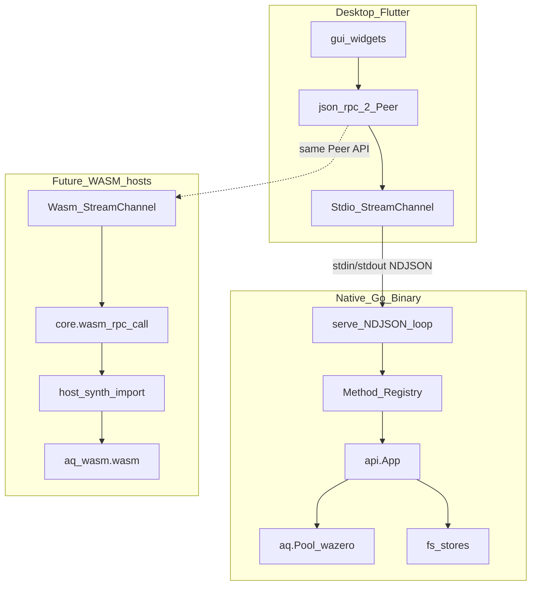

# Flutter GUI 桥梁计划（desktop-first JSON-RPC）

- 状态：Implemented（桌面 stdio + codegen；wasm 仅骨架）
- 日期：2026-11-18
- 前置：[3-wasm-port.md](./3-wasm-port.md)（Implemented）、[2-cli-layer-refactor.md](./2-cli-layer-refactor.md)（Implemented；本计划**取代**其 §16 里 length-prefixed 帧草图，改用 JSON-RPC 2）
- 范围：Go 类型为唯一来源的 JSON-RPC 2 契约、`protocol/` 生成物、Dart 胶水、**桌面端** Flutter ↔ 原生 Go 二进制（stdio）。移动端 / Web 的 wasm 运行时只定架构与接口骨架，不在本轮交付。
- 非范围：完整 GUI 页面、IndexedDB 产品化持久化、TinyGo、浏览器产品 UI、在 Go-wasm 内嵌套 wazero。

## 目录

- [1. 最终决策](#sec-1)
- [2. 目标架构](#sec-2)
- [3. 目标目录](#sec-3)
- [4. 协议契约（Go 为唯一来源）](#sec-4)
- [5. 方法注册表](#sec-5)
- [6. Schema 与 Dart 代码生成](#sec-6)
- [7. 桌面运输层：stdio + JSON-RPC 2](#sec-7)
- [8. Dart 胶水（桌面）](#sec-8)
- [9. wasm 运输层（架构锁定，本轮骨架）](#sec-9)
- [10. 存储与合成在双运输下的行为](#sec-10)
- [11. 错误映射](#sec-11)
- [12. 测试与 CI](#sec-12)
- [13. 迁移步骤](#sec-13)
- [14. 验收清单](#sec-14)
- [15. 风险与取舍](#sec-15)
- [附录 A：文件映射](#sec-a)
- [附录 B：命令速查](#sec-b)

---


## 1. 最终决策

| 决策 | 结果 |
|---|---|
| 契约 | JSON-RPC 2.0；Go `core/api` 的 Req/Res 类型 + 方法注册表为唯一来源 |
| 生成物 | 根目录 `protocol/`（manifest + JSON Schema + 黄金用例）与 `gui/lib/gen/`（Dart 模型 + API 封装）；**提交进 git**；CI `git diff --exit-code` 防漂移 |
| Dart 生成 | 自写 Go `text/template`（不做 quicktype；不手写模型） |
| 桌面运输 | **stdio only**：Flutter 拉起原生 Go 二进制；NDJSON（一行一条 JSON-RPC 消息） |
| 桌面引擎 | Go 进程内 `cliopen` → `aq.Pool` / wazero（与 CLI 相同） |
| 桌面平台 | Linux / macOS / Windows Flutter；**不做**桌面 wasm |
| 移动 / Web | wasip1 `core.wasm`；移动用 [`wasm_run`](https://pub.dev/packages/wasm_run)，Web 用 `dart:js_interop`；Dart 做胶水 |
| wasm 合成 | **Go + host import**（`//go:wasmimport` → 宿主调 `aq_wasm`）；**不**走「Dart 旁路 synth、绕过 Go」 |
| 本轮范围（A） | 契约 + codegen + **桌面 stdio 端到端**（character / voice / config / synth）；wasm 只留 Transport 接口与文档骨架 |
| Serve 入口 | 隐藏的 `yukumo-script serve`（或同二进制同语义入口）；stdout **只**跑协议，禁止路径文案 / huh / preview |
| 与旧 Serve 草图 | [2-cli-layer §16](./2-cli-layer-refactor.md#sec-16) 的 length-prefixed 帧 **作废**；以本文件为准 |

目标依赖（本轮桌面）：

```text
gui (Flutter)
  ↓  spawn + NDJSON JSON-RPC 2
cli/cmd/yukumo-script  serve
  ↓
cli/serve（薄循环）── 仅依赖 core/api（+ cliopen）
  ↓
core/api  rpc 注册表 + App 用例
  ↓
core/internal/service → port →（cliopen）fs + runtime/aq
```

未来 wasm（骨架）：

```text
gui Dart Peer
  ↓  StreamChannel 适配器
wasip1 core.wasm  rpc_alloc / rpc_call / rpc_free
  ↓  Handle(JSON-RPC)
core/api App（Memory store）
  ↘ synth → //go:wasmimport host_synth → Dart/JS → aq_wasm.wasm
```

---


## 2. 目标架构



上层只认识 `Peer` + 生成的 `XxxApi`；运输层可替换。

---


## 3. 目标目录

```text
repo/
  protocol/                      # 生成物，提交
    manifest.json                # 方法：name、params/result schema 引用、错误种类
    schemas/*.json               # 每类型一个 JSON Schema
    testdata/                    # 黄金：请求 JSON ↔ 期望响应 JSON
  core/api/
    model.go / character.go / …  # 现有 DTO + App 方法（保持）
    rpc/                         # 新增：Req/Res、Method 注册表、Handle、错误映射
    cmd/gen/                     # 生成器：读注册表 → protocol/ + gui/lib/gen/
  cli/
    serve/                       # NDJSON 循环；Hidden cobra；只用 cliopen + rpc
    cmd/yukumo-script/           # 注册 serve
  gui/
    lib/
      gen/                       # Dart 生成物（模型 + XxxApi）
      bridge/
        transport.dart           # 抽象：StreamChannel 工厂
        stdio_transport.dart     # Process + NDJSON
        wasm_transport.dart      # 本轮 stub / TODO
      main.dart                  # 先能 smoke 调通即可，不做完整 UI
  docs/refactorings/4-flutter-gui.md
```

约定：

- `protocol/` 与 `gui/lib/gen/` **禁止手改**；改 Go 类型 / 注册表后 `go generate`。
- GUI **不** import Go；只消费生成的 Dart 与运输适配器。
- CLI 仍只依赖 `core/api`（+ `cliopen`）；`serve` 不进 `ui` / `render` / `play`。

---


## 4. 协议契约（Go 为唯一来源）

### 4.1 类型约定

结构体用 `json` tag；约束写在 `jsonschema` tag（以所选反射库为准，倾向 `invopop/jsonschema`）：

```go
type CreateVoiceReq struct {
    Character string `json:"character" jsonschema:"required,minLength=1"`
    Name      string `json:"name"      jsonschema:"required"`
    // …
}
```

强制约定：

1. 业务字段不用 `interface{}` / `any`（引擎参数用具体结构或带 `kind` 的判别联合）。
2. 联合类型一律 `{"kind":"…", …}`，不用隐式 `oneOf` 匹配。
3. `map` 只允许字符串键。
4. `int` / `float64` 分清；时间用 RFC 3339 字符串。
5. 可选字段统一 `omitempty`；协议写死：**缺省即未设置**，不混用 `null` 与缺省。

现有 `api.Character` / `Voice` / `SynthParam` / `Config` / `SynthRequest` / `SynthResult` 已有 `json` tag，RPC Req/Res 优先**复用或薄包装**，避免平行两套模型长期分叉。

### 4.2 首批方法（桌面必须）

| JSON-RPC method | 对应 `api.App` | 备注 |
|---|---|---|
| `character.list` / `get` / `add` / `update` / `delete` | 现有 Character CRUD | |
| `voice.list` / `get` / `add` / `update` / `delete` / `duplicate` | 现有 Voice CRUD | |
| `voice.presets` / `voice.hasPreset` | `PresetNames` / `HasPreset` | 桌面有 Engine |
| `config.get` / `config.save` | `Config` / `SaveConfig` | |
| `synth.render` | `Synthesize` | 桌面：进程内 aq；请求固定 `Preview` 语义由 RPC 层关掉播放 |
| `rpc.negotiate`（可选） | — | 返回 protocol 版本 / 能力；首版可后置 |

通知（notification）：本轮不做；全部 request/response。

---


## 5. 方法注册表

注册表**同时**驱动运行时路由与 schema/Dart 生成，防止文档与实现分叉：

```go
type Method struct {
    Name   string
    Req    reflect.Type
    Res    reflect.Type
    Handle func(ctx context.Context, params json.RawMessage) (any, error)
}

func Def[Req, Res any](name string, f func(context.Context, Req) (Res, error)) Method { /* … */ }

func (r *Registry) Handle(ctx context.Context, raw []byte) []byte {
    // 解析 JSON-RPC 2 Request → 查表 → 编码 Result 或 Error
}
```

`serve` 与未来 `core.wasm` 的 `rpc_call` **共用**同一 `Registry` + `Handle`。

`Def` 内：`json.Unmarshal` 失败 → JSON-RPC `-32602 Invalid params`。

---


## 6. Schema 与 Dart 代码生成

### 6.1 生成器职责（`core/api/cmd/gen`）

1. 遍历 `Methods`，对每个 `Req`/`Res` 反射生成 `protocol/schemas/<Type>.json`。
2. 写 `protocol/manifest.json`（方法名、schema 引用、错误种类列表）。
3. 用 Go template 写 `gui/lib/gen/`：
   - 每类型：`fromJson` / `toJson` 类（可加 `==`；不做 freezed 依赖除非后续需要）。
   - 每域：`CharacterApi` / `VoiceApi` / `ConfigApi` / `SynthApi`，内部 `Peer.sendRequest`。

示例生成形态：

```dart
class VoiceApi {
  VoiceApi(this._rpc);
  final Peer _rpc;
  Future<CreateVoiceRes> create(CreateVoiceReq r) async =>
      CreateVoiceRes.fromJson(
        await _rpc.sendRequest('voice.add', r.toJson()) as Map<String, Object?>,
      );
}
```

### 6.2 触发与 CI

- `//go:generate` 挂在 `core/api/rpc`（或 `cmd/gen` 文档说明）。
- `just gen-protocol`（或等价）跑生成器。
- CI：生成后再 `git diff --exit-code -- protocol/ gui/lib/gen/`，不干净则失败。

---


## 7. 桌面运输层：stdio + JSON-RPC 2

### 7.1 帧格式

- **NDJSON**：一行一个完整 JSON-RPC 2 对象（UTF-8，`\n` 分隔）。
- stdin → 请求；stdout → 响应；**诊断只写 stderr**。
- Parent 关闭 stdin → EOF → 进程干净退出（`App.Close`）。

不用 LSP 式 `Content-Length`（实现更重）；若日后二进制 WAV 过大导致行缓冲问题，再评估 base64 字段或单独流——首版 WAV 仍放在 JSON result 的 base64 / 字节数组约定里（生成器与 schema 写死一种，推荐 **标准 base64 字符串字段**）。

### 7.2 进程生命周期

```text
Flutter
  → Process.start(<bundled or PATH yukumo-script>, ["serve", …flags])
  → stdin/stdout 接到 StreamChannel<String>
  → Peer(channel)
  → 退出时：关闭 stdin 或发 shutdown（若实现）并 wait
```

二进制发现（桌面首版）：

1. 开发：`YUKUMO_RPC_BIN` 或相对仓库 `cli` 构建产物路径。
2. 发布：随 Flutter 桌面产物一并打包（具体打包脚本本轮可最小：文档 + 环境变量，完整 installers 后置）。

### 7.3 cobra `serve`

- `Hidden: true`；从 browse / MenuSpec 过滤（沿用 [2-cli-layer](./2-cli-layer-refactor.md) 约定）。
- `SilenceUsage` / `SilenceErrors`；`DefaultInteractive` **不得**改变 serve 语义。
- 组合根：`cliopen.Open` → 注册表绑定 `*api.App` → NDJSON 循环调用 `rpc.Handle`。
- **禁止** `render` / `play` / 路径文案写 stdout。

### 7.4 与旧 §16 的关系

| 项   | 2-cli-layer §16 草图         | 本计划                                       |
| --- | -------------------------- | ----------------------------------------- |
| 帧   | 4-byte LE length + payload | NDJSON JSON-RPC 2                         |
| 方法面 | 偏 synth-only               | character / voice / config / synth        |
| 落点  | `cli/serve` → api          | 同左；**Handle 在** `core/api/rpc` 以便 wasm 复用 |

---


## 8. Dart 胶水（桌面）

依赖（`gui/pubspec.yaml`）：

- `json_rpc_2`
- `stream_channel`
- （桌面）标准 `dart:io` `Process`

结构：

```dart
abstract class RpcTransport {
  Future<StreamChannel<String>> connect();
  Future<void> close();
}

class StdioRpcTransport implements RpcTransport { /* Process + NDJSON */ }

class WasmRpcTransport implements RpcTransport {
  // 本轮：UnimplementedError 或编译期条件 stub
}
```

应用启动（桌面）：

```dart
final transport = StdioRpcTransport(binary: resolveYukumoBin());
final channel = await transport.connect();
final peer = Peer(channel)..listen();
final characters = CharacterApi(peer);
// smoke: await characters.list(…)
```

上层 UI 不感知运输层。

---


## 9. wasm 运输层（架构锁定，本轮骨架）

> 本轮**不要求**可运行的 Android / iOS / Web 合成；下列为后续实现的硬约束，避免桌面契约事后翻案。

### 9.1 导出面（wasip1 reactor）

```go
//go:wasmexport rpc_alloc
//go:wasmexport rpc_free
//go:wasmexport rpc_call   // 入参 ptr+len；返回 (ptr<<32)|len；体内调用同一 rpc.Handle
```

宿主流程：`_initialize` → `rpc_alloc` 写请求 → `rpc_call` → 读响应 → `rpc_free`。内存增长后须重新取 `memory.buffer` 视图。

构建示意：

```text
GOOS=wasip1 GOARCH=wasm go build -buildmode=c-shared -o core.wasm ./cmd/wasm
```

### 9.2 运行时分工

| 宿主 | Go core | aq |
|---|---|---|
| 移动 | `wasm_run` 加载 `core.wasm` | Dart 实现 `host_synth`，内部再加载 `aq_wasm.wasm` |
| Web | `dart:js_interop` 加载 `core.wasm` | 同上（JS/Dart 调 `aq_wasm`） |

### 9.3 `host_synth`（已锁定）

- Go 侧声明 `//go:wasmimport`（或等价宿主导入），在 wasm 组合根把 `port.Engine` 接到该导入。
- **所有平台对外仍是同一** `synth.render` **JSON-RPC**；桌面用进程内 wazero，wasm 用 host import。
- 同步限制：`rpc_call` 返回前必须完成；禁止在 handler 里挂起等宿主异步。存储用「启动注入快照 + 变更后由宿主落盘」（与 [3-wasm-port](./3-wasm-port.md) 的 Memory + Flush 模型一致）。
- 单线程：勿在 handler 返回后依赖未泵动的 goroutine。

### 9.4 本轮交付物（wasm）

- Dart `RpcTransport` 抽象 + `WasmRpcTransport` 空壳 / 注释接口。
- 本文档 §9 作为后续立项依据。
- **不**提交可运行 `core.wasm` 产品管线（可另开 `5-…` 计划）。

---


## 10. 存储与合成在双运输下的行为

| | 桌面 stdio | 未来 wasm |
|---|---|---|
| Config / Character store | `cliopen` → FS | Memory（宿主注入 / Flush） |
| Artifacts / Outputs | FS；synth 可写缓存与 `-o` 语义由请求字段控制 | 通常无 Outputs；缓存可选 Memory |
| Engine | `aq.Pool` | `host_synth` → `aq_wasm` |
| `synth.render` | 完整 `App.Synthesize` | 同方法名；引擎经 import |

桌面 RPC 层对 `SynthRequest`：强制关闭任何会污染协议流的 preview/播放；写盘策略仍由 core synth 服务与请求字段决定（与 CLI 一致），不要在 RPC 里复制一套策略。

---


## 11. 错误映射

| 来源 | JSON-RPC `code` | `data` / `message` |
|---|---|---|
| 解析失败 / 非 JSON-RPC | `-32700` / `-32600` | 短消息 |
| 未知 method | `-32601` | method 名 |
| Unmarshal / 校验失败 | `-32602` | 字段级信息（可放 `data`） |
| `api.ErrInvalid` | 应用码（如 `1`）或统一 `-32000` + `data.kind=invalid` | 选定一种并在 manifest 写死 |
| `api.ErrNotFound` | 同上 `not_found` | |
| `api.ErrExists` | 同上 `exists` | |
| 内部错误 | `-32603` | 不泄露敏感路径以外的细节；stderr 可打完整错误 |

首版推荐：**标准码 +** `error.data.kind`（`invalid` / `not_found` / `exists` / `internal`），便于 Dart 分支；具体数字在 `protocol/manifest.json` 固定。

---


## 12. 测试与 CI

| 层 | 内容 |
|---|---|
| Go unit | `rpc.Handle`：合法请求、Invalid params、NotFound、未知 method |
| 黄金 | `protocol/testdata/*`：请求 JSON → 响应 JSON（可对 Fake App / Memory） |
| 集成（桌面） | 起 `yukumo-script serve`，用 Go 或 Dart 客户端打 `character.list` / `synth.render` |
| 生成漂移 | CI：`just gen-protocol` + `git diff --exit-code` |
| 边界 | 现有 `check-cli-imports` / depguard：`serve` 不得 import `ui`/`render`/`play`；`core/api` 根包仍不 import `runtime`（引擎只在 cliopen） |

`just ci` 增加 protocol 漂移检查；完整 Flutter widget 测试本轮不强制。

---


## 13. 迁移步骤

### Phase 0 — 文档与分支

- [ ] 本文件状态 → In Progress；分支名建议 `flutter-gui-bridge`。
- [ ] 在 [2-cli-layer §16](./2-cli-layer-refactor.md#sec-16) 顶部加指针：「实现以 4-flutter-gui 为准」。

### Phase 1 — RPC 注册表与错误映射

- [ ] 新增 `core/api/rpc`：`Def` / `Registry` / `Handle`。
- [ ] 为 character / voice / config / synth 注册方法（包装 `*api.App`）。
- [ ] 单元测试覆盖错误路径。

### Phase 2 — 生成器 → `protocol/`

- [ ] `cmd/gen` + `invopop/jsonschema`（或选定库）。
- [ ] 产出 `manifest.json` + `schemas/`。
- [ ] `just gen-protocol` + CI diff gate。

### Phase 3 — Dart 生成物

- [ ] 模板生成 `gui/lib/gen/` 模型与 `XxxApi`。
- [ ] `gui/pubspec.yaml` 加入 `json_rpc_2` / `stream_channel`。

### Phase 4 — 桌面 `serve` + Flutter stdio

- [ ] `cli/serve` NDJSON 循环 + Hidden cobra。
- [ ] `StdioRpcTransport` + 二进制发现约定。
- [ ] Smoke：list characters、get config、一次 `synth.render`（需 `aq_wasm.wasm` 与现有 CLI 相同环境）。

### Phase 5 — wasm 骨架（不交付运行）

- [ ] Dart `RpcTransport` 抽象；`WasmRpcTransport` stub。
- [ ] 在 AGENTS / 本文件确认 `host_synth` 锁定；可选空 `cmd/wasm` 包注释，不进 CI 绿路径也可。

### Phase 6 — 收尾

- [ ] 更新根 [AGENTS.md](../../AGENTS.md) TOC（若增加 `gui/` / `protocol/` 说明）。
- [ ] 本文件状态 → Implemented；记录 commit；`just ci` 绿。

---


## 14. 验收清单

- [ ] 桌面 Flutter（或最小 Dart 客户端）经 stdio JSON-RPC 能完成 character / voice / config 读写与至少一次合成。
- [ ] stdout 在 `serve` 模式下无非 JSON-RPC 行。
- [ ] `protocol/` 与 `gui/lib/gen/` 由生成器产生且 CI 防漂移。
- [ ] 注册表与 `Handle` 可被单元测试在无 OS UI 下驱动。
- [ ] CLI 原有 one-shot / interactive 行为不变；`serve` 不影响 browse。
- [ ] wasm 路径有明确 Transport 抽象与 `host_synth` 文档；不要求本轮移动端 / Web 跑通。

---


## 15. 风险与取舍

| 风险 | 取舍 |
|---|---|
| WAV 进 NDJSON 体积大 | 首版 base64；必要时后续加独立二进制帧，契约版本化 |
| Go wasm 体积大 | 本轮不交付；日后评估 TinyGo（可能冲击 reflect 注册表） |
| 同步 `rpc_call` | 核心只做纯逻辑；异步 IO 留宿主 |
| 双运输行为差 | 同一 method 名与 schema；差异只在组合根（FS vs Memory、wazero vs host_synth） |
| 生成器维护成本 | 类型集合小、约定严；自写模板比 quicktype 更可控 |
| 与 §16 帧协议读者混淆 | 本文件取代；在 §16 加指针 |

---


## 附录 A：文件映射

| 路径 | 动作 |
|---|---|
| `core/api/rpc/*.go` | 新增 Registry / Handle / 错误 |
| `core/api/cmd/gen/` | 新增生成器 |
| `protocol/**` | 生成并提交 |
| `cli/serve/` | 新增 NDJSON serve |
| `cli/root.go`（或等价） | 注册 Hidden `serve` |
| `gui/pubspec.yaml` | 加依赖 |
| `gui/lib/gen/**` | 生成并提交 |
| `gui/lib/bridge/**` | 新增运输层 |
| `justfile` | `gen-protocol` + CI gate |
| `docs/refactorings/2-cli-layer-refactor.md` §16 | 加「以 4 为准」指针 |
| `docs/refactorings/4-flutter-gui.md` | 本计划 |

---


## 附录 B：命令速查

```bash
# 生成协议与 Dart
just gen-protocol

# 构建 CLI（含 serve）
just build

# 手测 serve（一行 JSON 请求）
printf '%s\n' '{"jsonrpc":"2.0","id":1,"method":"character.list","params":{}}' \
  | yukumo-script serve

# Flutter 桌面（开发）
export YUKUMO_RPC_BIN=$PWD/path/to/yukumo-script
cd gui && flutter run -d linux   # 或 macos / windows
```
